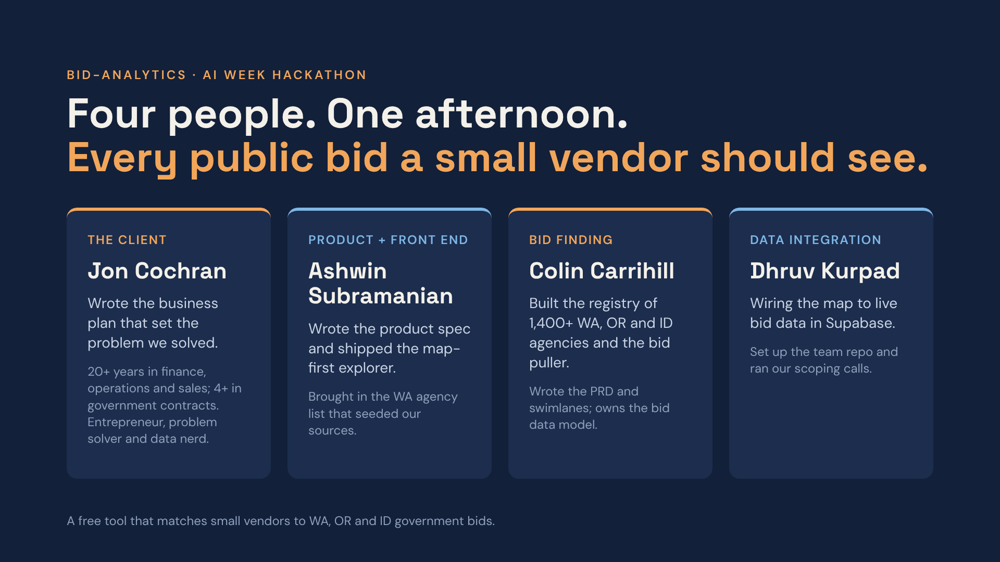

# Bid Analytics

**We help businesses win government contracts.**

**Try it now: [bid-analytics-mauve.vercel.app](https://bid-analytics-mauve.vercel.app/)**

Bid Analytics is a free tool that shows small businesses the government jobs posted near them. Describe what your business does in plain words, and it puts matching public bids on a map of Washington, each one labeled with how well it fits you and why.

> Built at the Claude Impact Lab Hackathon (Seattle AI Week, October 2026). The app runs on clearly labeled sample listings today. The source list behind it, 1,450+ state and local agencies across Washington, Oregon and Idaho, is real and loaded into our database.

## Who it's for

Think "two guys with a truck." A two-person pothole repair crew. A family landscaping company. A janitorial business that has never bid on a public job. They do great work, but public jobs are scattered across hundreds of city, county, school district, utility and state websites, and the best local jobs are the hardest to find.

Bid Analytics does the digging so they don't have to.

## What you can do with it

1. **Make an account.** Pick a username and password. That's it.
2. **Tell it about your business.** Write a sentence or two, like *"We do asphalt patching and crack sealing around Tacoma, two trucks, no bonding yet,"* and add your city or ZIP code.
3. **Answer a few quick questions.** It asks at most three follow-ups, then shows you the profile it built. Fix anything it got wrong and confirm.
4. **See your matches.** Open bids appear on the map and in a list. Each one gets a plain label (**Good fit**, **Possible fit**, **Needs review** or **Not a fit**) with the reasons behind it, for example a missing license or an area you don't serve. No mystery scores.
5. **Narrow it down.** Filter by type of work, county, agency or deadline, or pan the map and tap **Search this area**.
6. **Open a bid and reach out.** The detail view shows the deadline, requirements, and the agency's own website, email and phone, with copy buttons. Save the ones you like.
7. **Get help winning it.** On a Good fit or Possible fit, tap **Book a call with Jon** to schedule time with a government contracting expert who will walk you through the requirements and your bid.

## Get started (no code)

1. Go to **[bid-analytics-mauve.vercel.app](https://bid-analytics-mauve.vercel.app/)** on your phone or computer.
2. Create an account with a username and password.
3. Describe your business and follow the steps above. That's all the setup there is.

Nothing to install and nothing to pay. In this demo the listings are labeled sample data, and your account and profile reset when you reload the page.

## Where the bids come from

Most local work never reaches the big state portals. It's posted on a city's purchasing page, a school district's bid board or a utility's vendor portal. We built a registry of those places:

- **1,450+ sources** across Washington, Oregon and Idaho.
- State agencies, cities, counties, school districts, public utility districts, ports, hospitals and other local agencies. We focus on state and local work only, not federal bids.
- Each source records its procurement page (when we know it) and which shared bid platform it uses, so one reader can cover many agencies at once.

The registry is in [`data/sources.seed.json`](data/sources.seed.json) and loaded into our Supabase database. The map currently covers Washington; Oregon and Idaho come next.

## What's next

- Show live bids on the map. The bid puller already reads CivicPlus, OpenGov and OregonBuys portals, which together cover many agencies at once; next is running it on a schedule and switching the app to live data.
- Turn on Oregon and Idaho in the app.

## Team



| Who | Role |
|---|---|
| Jon Cochran | Client and domain expert: government contracting, business plan |
| Ashwin Subramanian | Product spec and the map explorer app |
| Dhruv Kurpad | Backend and integration: repo setup, wiring the map to Supabase |
| Colin Carrihill | Bid data: the 1,400+ source registry, bid data model, bid puller, product requirements |

## How we built it

Four people, one afternoon, each with a lane: Jon brought the domain knowledge and the problem, Ashwin wrote the spec and built the app, Colin built the bid data, and Dhruv wired them together. Much of the code and data work was done with Claude, in separate threads for the registry, the bid puller, the front end and the docs. Every change went in through a pull request you can read in the [history](https://github.com/bid-hackathon/Bid-Analytics/pulls?q=is%3Apr).

## Host your own copy

Most businesses should just use the link above. If you want your own copy, for example to change the **Book a call** link, either of these works without writing code.

### Put a copy online with Vercel

You need a free [GitHub](https://github.com/signup) account and a free [Vercel](https://vercel.com/signup) account (you can sign up for Vercel with GitHub).

1. Click this button:

   [](https://vercel.com/new/clone?repository-url=https%3A%2F%2Fgithub.com%2Fbid-hackathon%2FBid-Analytics&project-name=bid-analytics)

2. Sign in when asked, keep the default settings, and click **Deploy**.
3. When it finishes, click **Visit**. Your copy is live at a web address you can bookmark or share with your team.
4. Create an account on the first screen.

You don't need to change any settings. Out of the box it runs on the sample listings, so you can try every feature right away. If you want the **Book a call** button to point to your own scheduling page, add a setting named `NEXT_PUBLIC_BOOKING_URL` with your Calendly (or similar) link in Vercel under **Settings → Environment Variables**, then redeploy.

### Run it on your own computer

This takes a few minutes and one program.

1. Install [Node.js](https://nodejs.org) (choose the "LTS" version and click through the installer).
2. On this page, click the green **Code** button, then **Download ZIP**, and unzip it.
3. Open a terminal in the unzipped folder (on a Mac, right-click the folder in Finder and choose **New Terminal at Folder**; on Windows, open the folder, type `cmd` in the address bar and press Enter).
4. Copy and paste these two lines, pressing Enter after each:

   ```
   npm install
   npm run dev
   ```

5. Open <http://localhost:3000> in your browser.

## For developers

- **Front end:** Next.js app in `src/`. Run, test and build instructions, the code layout, and the API it expects are in [`docs/FRONTEND.md`](docs/FRONTEND.md). `NEXT_PUBLIC_DATA_MODE=fixtures` (the default) uses sample data; `live` calls the `/api/v1` backend.
- **Data:** schema in [`supabase/migrations/`](supabase/migrations/), seed in [`supabase/seed.sql`](supabase/seed.sql), bid fields in [`docs/bid-data-model.md`](docs/bid-data-model.md), registry notes in [`data/README.md`](data/README.md).
- **Connecting the app to Supabase:** field-by-field mapping from the database to the app in [`docs/supabase-frontend-integration.md`](docs/supabase-frontend-integration.md).
- **Secrets:** copy `.env.example` to `.env.local` and fill in your own keys. Never commit a real `.env`.
- **Spec:** [`Washington_Contract_Explorer_SRS.md`](Washington_Contract_Explorer_SRS.md).
- **All docs and scripts:** [`docs/README.md`](docs/README.md).

## License

[MIT](LICENSE). Free to use, copy and adapt.
