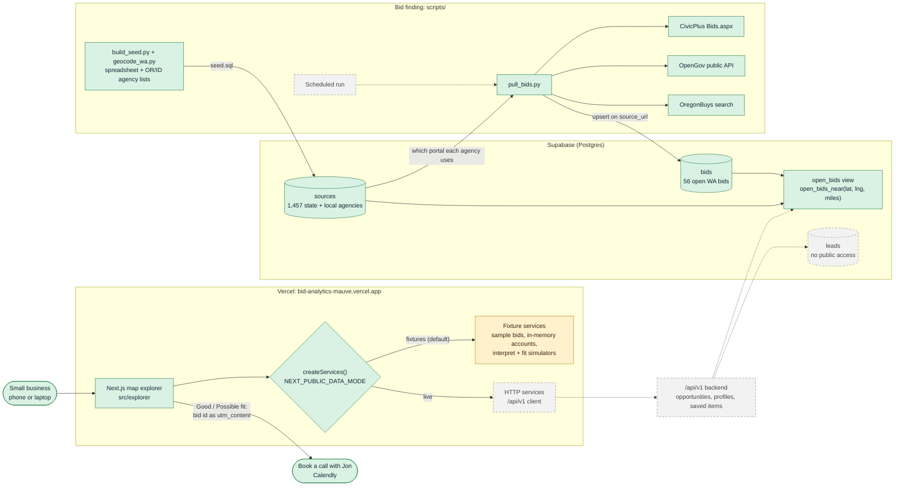

# System design

How Bid Analytics fits together today, and what is still sample data or planned. Scope is state and local agencies in Washington, Oregon and Idaho. Federal bids (SAM.gov) are out of scope.

## Diagram

Solid green boxes are live, amber boxes run on sample data, and dashed grey boxes are planned.

## Requirements

**What it does.** A vendor describes their business in plain words, confirms a short profile, and sees open public bids on a map of Washington, each labeled Good fit, Possible fit, Needs review or Not a fit with reasons. No numeric scores and no pricing; win rates and bid pricing are roadmap only. From a fitting bid the vendor can book a call with Jon.

**Constraints.** Built in one afternoon by four people, so everything is hosted (Vercel, Supabase) and nothing needs a server we run. A small business must be able to use it, or deploy a copy, with no code.

## Components

| Component | Where | Status |
|---|---|---|
| Map explorer (accounts, onboarding, filters, map, detail, saved items) | `src/explorer`, `src/map` | Live on Vercel |
| Data mode switch | `src/lib/services/index.ts` | Live; defaults to `fixtures` |
| Sample listings, accounts, profile interpreter and fit rules | `src/lib/services/fixtureServices.ts`, `src/lib/sim/` | Sample data; accounts reset on reload |
| `/api/v1` backend the live mode calls | Not built (client in `httpServices.ts`) | Planned |
| Source registry | `data/sources.seed.json`, `supabase/seed.sql`, built by `scripts/build_seed.py` | Live, 1,457 sources loaded |
| Bids table, `open_bids` view, `open_bids_near()` radius search | `supabase/migrations/` | Live, 56 real open WA bids |
| Bid puller with CivicPlus, OpenGov and OregonBuys adapters | `scripts/pull_bids.py` | Works on demand; no schedule yet |
| Leads table for expert handoffs | `supabase/migrations/20261025000000_source_registry.sql` | Table exists; nothing writes to it yet |
| Book a call with Jon | `src/lib/booking.ts` | Live; Calendly link, overridable with `NEXT_PUBLIC_BOOKING_URL` |

## Data flow

1. **Registry.** `build_seed.py` merges the team spreadsheet with the Oregon and Idaho agency lists and WA fixes, `geocode_wa.py` adds coordinates, and `seed.sql` loads them into `sources`. Each source records its procurement page and the shared platform it uses.
2. **Pulling bids.** `pull_bids.py` reads the registry, picks an adapter per source platform, skips federal and non WA/OR/ID sources, and upserts rows into `bids` keyed on `source_url`. Without a secret key it writes a dry-run JSON file instead.
3. **Serving.** `open_bids` joins open bids to their source for location and county; `open_bids_near()` filters by distance for the "search this area" map view. Row level security allows public reads of `sources` and `bids` only.
4. **Matching.** Today the profile interpreter and fit rules run in the browser against sample listings. In live mode they move behind `/api/v1`.
5. **Handoff.** On a Good or Possible fit, the app opens Jon's Calendly with only the bid id attached. No profile or account details leave the browser.

## Trade-offs

- **Shared platform adapters over per-agency scrapers.** One CivicPlus or OpenGov reader covers many agencies, so coverage grows with the registry. Agencies on custom pages (King County, Snohomish County, Kent, Renton, Tacoma) are not covered yet.
- **Fixtures by default.** The deployed demo always works and anyone can deploy a copy with no keys, at the cost of showing sample listings instead of the 56 real bids already in Supabase.
- **Postgres views and functions instead of a custom API layer.** Radius search lives in SQL, so a thin API (or Supabase's REST endpoint) can serve the map directly.
- **Rule-based fit labels, not scores.** Labels with reasons are explainable to a first-time bidder and follow the product rule against mystery scores.

## What to revisit as it grows

- Build `/api/v1` (or point the app at Supabase directly, see [`supabase-frontend-integration.md`](supabase-frontend-integration.md)) and switch the deployment to live data.
- Run `pull_bids.py` on a schedule, mark bids closed when they drop off a portal, and alert when an adapter returns zero rows.
- Add adapters for custom agency pages and turn on Oregon and Idaho in the app.
- Write handoffs to `leads` so Jon sees the vendor's profile with the call, and move accounts from in-memory to Supabase Auth.
